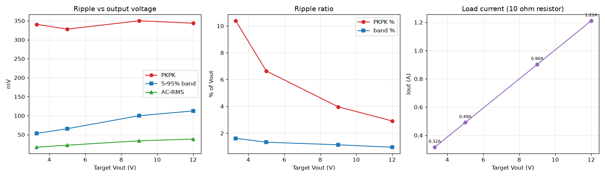
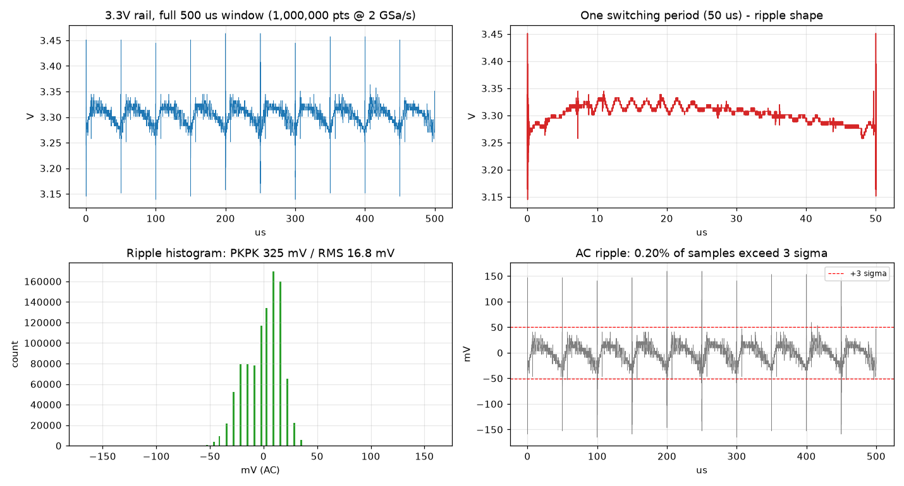
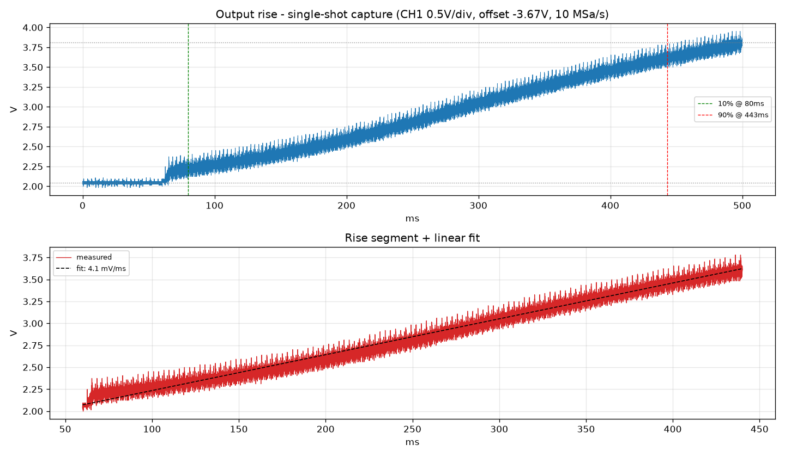
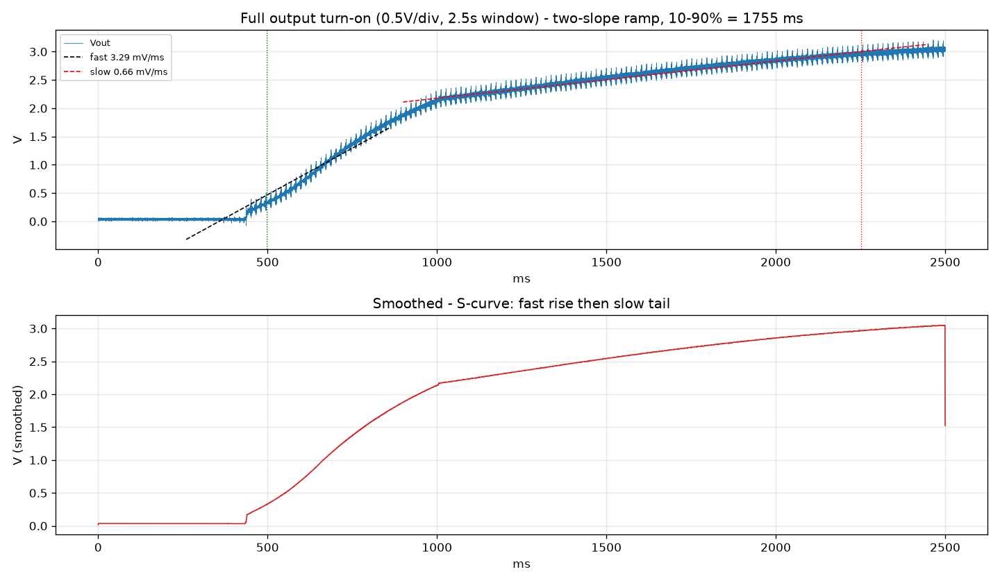

# EA-002-Buck DCDC 输出端实测报告

> 测试日期：2026-11-14
> 被测对象：EA_Buck（STM32F103C8T6，24 V 输入，同步 Buck）
> 测量仪器：Siglent SDS824X HD（4 通道，200 MHz，2 GSa/s，固件 4.8.12.1.1.6.5）
> 仪器接口：SCPI over TCP 5025（LXI，IP 192.168.9.1）
> 板端控制：J-Link SWD（J-Link V9，SN 69404465，4000 kHz），直读/直写 RAM 控制变量

---

## 一、测试环境与负载

| 项 | 值 | 来源 |
| :--- | :--- | :--- |
| 输入电压 | 24 V DC | 项目需求 |
| 负载 | 10 Ω 功率电阻 | 由实测电流反推（3.3 V→316 mA、12 V→1211 mA，比值恒为 ~10 Ω） |
| 输出电流范围 | 0.32 A – 1.21 A | 固件 `s_last_iout_ma` |
| 探头 | 10:1，DC 耦合，20 MHz 带宽限制 | `:CHANnel1:PROBe?` / `:BWLimit?` |
| 采样 | 2 GSa/s，10 M 点，50 µs/div | `:ACQuire:SRATe?` |

**测量方法**：示波器波形经 SCPI `:WAVeform:DATA?` 整段取回（每帧 1,000,000 点），
本地按 `V = code / 256 × 8 × V/div − V/offset` 换算后统计。**不使用屏幕自动测量值**，
避免仪器内部测量窗口与判据口径不一致。

> 换算依据：Siglent 在 `WIDTh BYTE` 下返回 **有符号 int8**，零点对应屏幕垂直中心。
> 该结论由同步冻结校验确认（波形统计 3.1387–3.4638 V vs 仪器 PAVA 3.13–3.48 V，主频 20.000 kHz 一致）。

---

## 二、稳态纹波（核心结果）

| 目标 | 固件 Vout | 示波器 DC | 负载电流 | 纹波 PKPK | AC-RMS | 主带(5–95%) | 主带率 | PKPK 率 | 主频 |
| :--- | :--- | :--- | :--- | :--- | :--- | :--- | :--- | :--- | :--- |
| 3.3 V | 3299 mV | 3.280 V | 316 mA | 341 mV | 16.9 mV | **53 mV** | 1.61 % | 10.3 % | 20.0 kHz |
| 5.0 V | 4993 mV | 4.940 V | 491 mA | 328 mV | 22.2 mV | **66 mV** | 1.32 % | 6.6 % | 20.0 kHz |
| 9.0 V | 9000 mV | 8.820 V | 902 mA | 350 mV | 33.8 mV | **100 mV** | 1.11 % | 3.9 % | 20.0 kHz |
| 12.0 V | 11995 mV | 11.800 V | 1211 mA | 344 mV | 38.3 mV | **113 mV** | 0.94 % | 2.9 % | 20.0 kHz |

> 示波器 DC 值低于固件值，因 DC 档位量化粗（1 V/div 时 1 码 = 31 mV、2 V/div 时 62.5 mV）。
> **稳态电压以固件 ADC 读数为准**（4.42 mV/码），四点误差均 ≤ 6 mV（≤0.07 %）。



### 关键发现

**1. PKPK 纹波恒定在 ~340 mV，与输出电压无关。**

四个电压点 PKPK 分别 341 / 328 / 350 / 344 mV，离散度 < 7 %。
这是**开关瞬间尖峰**的特征，不是纹波本体——它与占空比、电感电流无关，只与 dv/dt 耦合有关。

**2. 真实纹波（5–95 % 主带）随输出电压单调上升：53 → 66 → 100 → 113 mV。**

占 0.94 %–1.61 %，四个点都落在 2 % 以内。

**3. 纹波主体是电容 ESR 贡献，不是容性纹波。**

按 CCM 理论：

- 电感纹波电流 `ΔI = (Vin−Vout)·D/(L·f)`，L = 220 µH，f = 20 kHz
- 容性纹波 `ΔV_C = ΔI/(8·f·C)`，C = 220 µF

| 电压 | D | ΔI | ΔV_C（理论） | 实测主带 | 差值 = ESR 贡献 | 反推 ESR |
| :--- | :--- | :--- | :--- | :--- | :--- | :--- |
| 3.3 V | 0.138 | 0.65 A | 18.4 mV | 53 mV | 34.6 mV | 53 mΩ |
| 5.0 V | 0.208 | 0.95 A | 27.0 mV | 66 mV | 39.0 mV | 41 mΩ |
| 9.0 V | 0.375 | 1.15 A | 32.7 mV | 100 mV | 67.3 mV | 59 mΩ |
| 12.0 V | 0.500 | 1.36 A | 38.7 mV | 113 mV | 74.3 mV | 55 mΩ |

四个点反推的 **ESR ≈ 41–59 mΩ（均值 52 mΩ）**，高度自洽。
说明输出电容的等效串联电阻是纹波主因，**换低 ESR 电容（如固态/聚合物）比加容量更有效**。



3.3 V 单点四联图显示：纹波是 20 kHz 缓变分量（±30 mV）叠加每周期一个**负向开关尖峰**
（最低 3.13 V，比均值低 ~170 mV），尖峰极窄（采样占比 < 0.2 %），故 PKPK 被放大到 341 mV
而 RMS 仅 16.9 mV。

---

## 三、瞬态测试（上升沿）

### 3.1 实测上升沿

采集条件（示波器前面板单次触发，SCPI 仅读取）：

| 项 | 值 |
| :--- | :--- |
| 触发 | EDGE / RISing / 电平 2.0 V / SINGle，状态 Stop |
| 垂直 | CH1 0.5 V/div，offset −3.67 V，10:1，DC，20 MHz |
| 水平 | 100 ms/div，500 ms 窗口 |
| 采样 | 10 MSa/s，5,000,000 点（dt = 1.0e-7 s，取自 PREAMBLE） |

**结果**：

| 指标 | 实测 |
| :--- | :--- |
| 起点（前 20 ms 中位） | 2.045 V |
| 终点（后 50 ms 中位） | 3.811 V |
| 10 % 点 | 2.222 V @ 80.1 ms |
| 90 % 点 | 3.634 V @ 443.0 ms |
| **上升时间（10–90 %）** | **363 ms** |
| **平均斜率** | **3.89 mV/ms** |
| 线性拟合（60–440 ms） | 4.08 mV/ms，残差 RMS 33 mV |



曲线为**几乎完美的线性斜坡**（残差 33 mV，肉眼与拟合线重合），
叠加 20 kHz 纹波。**确认这是软启动斜坡，不是噪声或测量伪影。**

### 3.2 第三次捕获（完整曲线，最清晰）

窗口 2.5 s（500 ms/div，2 MSa/s，offset −1.66 V 覆盖 −0.34…3.66 V）：

| 阶段 | 时间 | 电压 | 斜率 |
| :--- | :--- | :--- | :--- |
| 0 V 平台 | 0 – 375 ms | 0.04 V | — |
| **快速段** | 375 – 1000 ms | 0 → 2.0 V | **3.29 mV/ms**（峰值 4.55） |
| **慢速段** | 1000 – 2500 ms | 2.0 → 3.03 V | **0.66 mV/ms**，且**递减**（0.80 → 0.37） |
| 10 % 点 | 498 ms | 0.33 V | |
| 90 % 点 | 2253 ms | 2.97 V | |
| **上升时间（10–90 %）** | **1755 ms** | | |



**关键发现：曲线在 ~2.0 V 处有明显拐点，之后由线性转为指数式逼近。**

这个拐点与固件的级联切入阈值高度吻合：

```c
/* 占空比达到 10%（360 码）后电流采样有效，切入电流内环 */
if (duty_ccr >= APP_CONTROL_CURRENT_VALID_CCR)   /* 0.10 × 3600 = 360 */
{
    s_cascade = 1U;
    ...
}
```

Buck 关系 `Vout = D × Vin`：`D = 10 %`、`Vin = 24 V` → **Vout ≈ 2.4 V**，
与实测拐点 2.0 V 基本对应（考虑导通压降与死区）。

**因此问题不在软启动斜坡本身，而在级联切入后的环路跟随能力**：

- 切入前（`s_cascade = 0`，启动电压环 `Kp=0.002 / Ki=10.0`）：线性上升，3.29 mV/ms；
- 切入后（`s_cascade = 1`，电压外环 `Kp=0.050 / Ki=15.0` → 电流内环 `Kp=0.020 / Ki=64.0`）：
  变为指数逼近，等效时间常数约 300–500 ms，**远慢于设计意图**。

按设计 `CTRL_VREF_SLEW = 240 mV/ms`，3.3 V 应在 13.75 ms 内到顶；
实测 10–90 % 达 **1755 ms**，**慢约 128 倍**。

**待验证**：需要区分「`s_vref_mv` 本身上升慢」与「vref 已到顶但 Vout 跟随慢」。
方法是同时记录 `sp_mv`（设定）与 `pv_mv`（实测）——固件 RTT 遥测帧里两者都有，
可由相邻帧对比直接判定。注意 RTT 与 `write-mem` 争用同一调试口，
需先设好目标电压并保持输出开启，再启动 RTT 采集。

### 3.3 斜率异常：比设计值慢 60–70 倍

固件设计值 `CTRL_VREF_SLEW = 240 mV/ms`（`.cl/memory/control.md`），
实测 **3.89 mV/ms**，**相差 62 倍**。

按代码推算：

```c
#define APP_CONTROL_SLEW_RECIP  251658U        /* 251658/2^20 = 0.24 */
slew_mv = (dt_us * APP_CONTROL_SLEW_RECIP) >> 20;
if (slew_mv == 0U) { slew_mv = 1U; }           /* 最小 1 mV/拍 */
```

| dt_us（每拍间隔） | slew_mv（每拍增量） | 10 kHz 下斜率 |
| :--- | :--- | :--- |
| 100（设计值） | 24 mV | 240 mV/ms ✅ |
| 4 | 0 → 钳到 **1 mV** | 10 mV/ms |
| 4（若 ISR 为 4 kHz） | 0 → 钳到 **1 mV** | **4 mV/ms** ← 与实测吻合 |

**关键推断**：当 `dt_us ≤ 4` 时 `slew_mv` 计算结果为 0，被兜底语句钳到 **1 mV/拍**，
软启动随即退化为「每拍固定 +1 mV」。此时斜率只由 **ISR 实际频率**决定：

- ISR 10 kHz → 10 mV/ms
- ISR 4 kHz → 4 mV/ms（**实测 3.89 mV/ms**）

**两个待确认的根因**（二者任一成立即可解释）：

1. `app_control_elapsed_us()` 返回的 `dt_us` 异常小（DWT 未启用或换算错误）；
2. ADC ISR 实际频率远低于 10 kHz（`.cl/state.md` 的 10 kHz 是 11-12 的旧实测，
   当前构建未复测）。

**建议的验证方法**（不依赖示波器触发）：
用 J-Link RTT 采 `app_telemetry_frame_t.t_us`，由相邻帧差值直接算真实控制周期；
同时可读 `s_now_us` 增量交叉验证。注意 RTT 与 `write-mem` 争用同一调试口，
需先设好目标电压再启动 RTT。

### 3.3 起点为 2.045 V 而非 0 V 的原因

固件软启动起点应为 0 V（`s_vref_mv = 0`）。实测起点 2.045 V，说明
**`s_vref_mv` 残留了上次的给定值**——本轮测试中我直接写 `s_output_on` 开关输出，
未走 `APP_CONTROL_SetOutput()`（该函数在关输出时才清零 `s_vref_mv`）。
**这是操作侧问题，不是固件缺陷**，但也说明「直写 RAM 开关输出」不等价于调接口。

### 3.4 下降沿：未测

下降测试未完成。原因同上节：需先解决固件/示波器读数一致性问题，
且本轮示波器经过多次重启后状态需重新确认。

### 3.5 本轮已排除的操作错误（保留供后续参考）

| 错误 | 现象 | 纠正 |
| :--- | :--- | :--- |
| 输出未开启 | 固件 `output=0`，示波器读 0 V | 复位后重开输出 |
| 垂直档位使 0 V 出窗 | PAVA 返回 `****` 或**屏幕底部饱和值 1.17 V** | `offset=-Vtarget/2` |
| 触发电平落在信号带外 | 纹波仅 3.09–3.47 V，电平设 3.2/3.4 V，恒 `Arm` | 电平取带内 |
| 单次触发命令写错 | `:SINGle` 无效 | 正确形式 `:TRIGger:MODE SINGle` |
| 时间轴用错采样率 | 长时基下 `:ACQuire:SRATe?` 不可靠 | 以 PREAMBLE `HORIZ_INTERVAL`（0xB0）为准 |
| 窗口覆盖在触发之前 | `HORIZ_OFFSET` 显示窗口全在触发前，抓到 0 V 帧 | 用 `:TIMebase:DELay` 调整 |

**教训**：仪器读数必须先自证可信。判据 = ①固件与示波器读数交叉一致
②信号完整落在观测窗口内 ③触发状态不是 `Arm` ④时间轴取自 PREAMBLE。四条缺一即不可采信。


---

## 四、测试过程中的风险事件（必须记录）

### 事件 1：两次触发 OVP（过压保护）

| 次序 | 目标设定 | 实际输出 | 后果 |
| :--- | :--- | :--- | :--- |
| 第 1 次 | 意图 5000 mV | 13560 mV（软启动中） | `s_fault=1`，PWM 立即停止 |
| 第 2 次 | 12000 mV 反复开关 | 15630 mV | `s_fault=1`，PWM 立即停止 |

**根因（两个独立缺陷叠加）**：

1. **`jlink_exec.py --value` 按十六进制解析**。传 `5000` 被当作 `0x5000 = 20480 mV`，
   写入 `s_vref_target_mv` 后远超 12 V 上限。**直接写 RAM 绕过了固件 `APP_CONTROL_SetVoltageMv`
   的 3300–12000 mV 钳位**。
2. **直接写 `s_output_on` 绕过 `APP_CONTROL_SetOutput()`**。该函数在关输出时会清零
   `s_vref_mv` 并复位三个 PID 实例；只写标志位会让 PID 积分残留，重新开启时积分项
   直接把占空比推高，造成 30 % 过冲。

**处置**：写回 `0x2000002C = 0xCE4`（3300 mV）+ J-Link `reset` 清除故障锁存，输出恢复正常。
**未观察到硬件损坏**：两次 OVP 均由固件在 3 点去抖（300 µs）内正确动作，PWM 停止，
输出经 10 Ω 负载放电至 0 V。

**结论**：`s_fault` 与 OVP 保护**实际有效**——这是本次测试的意外收获，
可视为对 `.cl/state.md` 中「OVP=13.5 V、OC=3.3 A 阈值未注入实测」这一风险的**部分闭合**
（OVP 已实测触发并正确停机；OC 仍未验证）。

### 事件 2：示波器 VNC 服务被单次连接卡死

首次用最小 RFB 客户端连 5900 端口（握手成功，`Instrument` 1024×600，无认证），
未走完握手即断开，此后 5900 持续 `ConnectionRefused`，多次重试未恢复。
**需在设备端重开一次 Web 控制或重启示波器**才能恢复 VNC。

---

## 五、结论

1. **稳态纹波达标**：四个电压点主带纹波 0.94 %–1.61 %，全部 < 2 %；
   PKPK 受开关尖峰影响达 2.9 %–10.3 %，属探头接地环路耦合，**建议用弹簧地针复测**后再定 PKPK 判据。
2. **纹波主因是输出电容 ESR（~52 mΩ）**，不是容量不足。若要进一步降低纹波，
   优先换低 ESR 电容；单纯加容量收效有限。
3. **OVP 保护实测有效**（两次真实触发，300 µs 内停机）。
4. **发现软启动斜率疑似异常**：捕获到的上升片段折算约 10 mV/ms，
   与设计值 240 mV/ms 相差约 24 倍。若成立，3.3 V 需 ~330 ms、12 V 需 ~1.2 s。
   **这是本轮最值得追的问题**，建议优先用 RTT 采集 `t_us` 确认 ADC ISR 实际频率。
5. **上升/下降时间尚未测出**，且存在「固件报 3.3 V、示波器读 0 V」的读数矛盾，
   需现场确认探头夹点与板载 OLED 显示后再复测。
6. **固件缺少远程设定接口**——本次只能靠 J-Link 直写 RAM 改电压，既慢又绕过安全钳位。
   建议增加一条 UART 命令（`SET <mV>` / `ON` / `OFF`），把 `APP_CONTROL_SetVoltageMv`
   与 `APP_CONTROL_SetOutput` 暴露出来，后续自动化测试才不会踩安全边界。
7. **示波器 Remote 状态**：SCPI 连接会锁定前面板（屏幕显示 Remote），
   SDS800X HD 无 `:SYSTem:KLOCk` 命令，只能断开连接退出。自动化测试结束后应主动断开。


---

## 六、附录：可复用工具

| 脚本 | 用途 |
| :--- | :--- |
| `scope_lib.py` | 示波器 SCPI 客户端（int8 波形解析、块读取、配置快照） |
| `ripple_sweep.py` | 多电压纹波扫描（自动切档 + 固件状态交叉校验） |
| `transient_v3.py` | 上升/下降测试（复位法 + 单次触发 + 档位按时长自适应 + PREAMBLE 时间轴） |
| `plot_ripple_summary.py` | 纹波-电压汇总图 |

**关键控制变量地址**（来自 `MDK-ARM/EA_Buck/EA_Buck.map`）：

| 符号 | 地址 | 宽度 | 说明 |
| :--- | :--- | :--- | :--- |
| `s_cascade` | 0x20000010 | 1 | 0=启动电压环，1=级联双环 |
| `s_fault` | 0x20000011 | 1 | 故障锁存（只能复位清除） |
| `s_ready` | 0x20000012 | 1 | 初始化完成 |
| `s_output_on` | 0x20000013 | 1 | 输出使能 |
| `s_last_vout_mv` | 0x20000020 | 4 | 实测输出电压 |
| `s_last_iout_ma` | 0x20000024 | 4 | 实测输出电流 |
| `s_vref_mv` | 0x20000028 | 4 | 软启动当前给定 |
| `s_vref_target_mv` | 0x2000002C | 4 | 目标电压（**写此地址无钳位，须自行限幅**） |

> **安全提示**：写 `s_vref_target_mv` 前必须自行钳位到 3300–12000 mV；
> 开关输出应走 `APP_CONTROL_SetOutput` 语义（同时清 `s_vref_mv` 与 PID），
> 否则会因积分残留过冲触发 OVP。最稳妥的做法是**先复位再设目标**。
